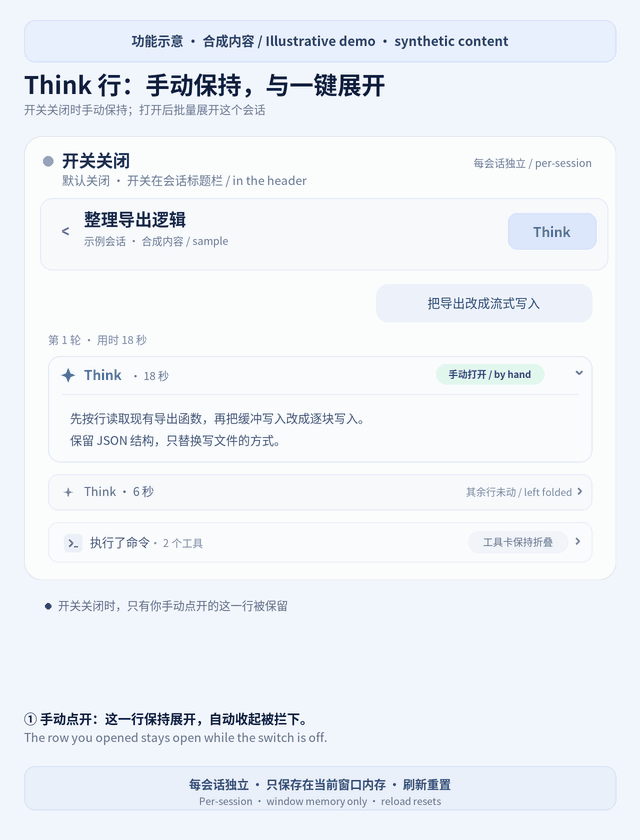

# dsh-think-expand

[](README.md) [](#dsh-think-expand)

DeepSeek Harness Web plugin. It does two things:

1. **Think rows you open by hand are no longer folded for you.** It works as soon as the plugin is installed, with no switch to press. DSH and the dsh-claude-style theme fold Think when the reasoning stops, when a process group's work ends, and when a turn finishes; the plugin keeps the rows you opened yourself open until you close them.
2. **A `Think` switch per session.** Press `Think` in a session's header and only that session, in that window, opens or closes all of its Think rows. Since DSH 0.1.7, Think rows live inside step groups and folded turns, so with the switch on the plugin first opens the groups and turns that hold a Think row, then expands the Think rows inside. Tool cards, context injections, and compaction rows stay as they are.

## Preview



*Illustrative demo with synthetic content. The animation first shows a manually opened Think row staying open, then expands the session's Think rows after pressing `Think` in the header. Tool cards stay collapsed. The real interface varies with the DSH version and theme.*

[View the still image](docs/demo.png)

## Install and first use

Needs `dsh` 0.1.7-rc.2 or later and the `web` profile. This version is adapted to the published code of the official 0.2.2-rc.1 web UI and the dsh-claude-style 0.20.1 theme (that theme needs dsh 0.2.2-rc.1 or later); the switch was tested by hand on 0.2.1-rc.4 with dsh-claude-style 0.19.5.

### Install from npm (recommended)

```sh
dsh plugin --profile web add dsh-think-expand
```

[npm package and versions](https://www.npmjs.com/package/dsh-think-expand). To upgrade, run the same command again, then restart the matching Web UI and reload the page.

### Install from GitHub

```sh
dsh plugin --profile web add github:BrianHIO-x/dsh-think-expand
```

For another profile, replace `web` with the profile that runs your Web UI.

### Start using it

1. Restart `dsh web` for that profile, then reload the page. The terminal should print `[dsh-think-expand] plugin loaded!`.
2. Open a session and expand a Think row yourself. The plugin keeps that row open by default; closing it yourself ends the keep.
3. To expand every Think row in the current session, click **`Think` in the session header**. Click again to collapse them. This bulk switch starts off and works separately from keeping manually opened rows open.

State lives in the current window only: **reloading or opening another window resets it**. Switching away from a session and back preserves it in that window. Tool cards stay as they are.

### Other installation options

[Releases](https://github.com/BrianHIO-x/dsh-think-expand/releases) provide a packaged `.tgz`. Download it and install the local file:

```sh
dsh plugin --profile web add /path/to/dsh-think-expand.tgz
```

You can also install a local development checkout:

```sh
dsh plugin --profile web add /path/to/dsh-think-expand
```

After either installation, restart the matching Web UI and reload the page.

DSH Go (the phone app): the plugin works in the app's web view and in web plugin panels. The app's own native chat list is drawn in Flutter, and folding a Think row when the reply ends is built into the app, so the plugin cannot change it there. To stop whole turns from folding into a one-line summary, turn off "Collapse steps when done" in the app's settings.

Uninstall:

```sh
dsh plugin --profile web remove dsh-think-expand
```

## Behavior

### Think rows you open stay open (on by default)

- Nothing to set up. It starts with the plugin, with the switch off as well.
- A Think row you open yourself (mouse, Enter or Space) is remembered, and these automatic folds are stopped or undone:
  - dsh-claude-style folds a Think row when its reasoning stops, and folds a process group when its work ends or a newer group appears in the same turn. The plugin stops those programmatic clicks at the window, before the theme sees them, so its fold animation never starts and nothing flickers.
  - DSH folds a turn when it finishes (the "took X min X s" row) and resets the Think rows inside. For the newest turn the plugin unfolds it again and reopens the rows you opened. An older turn folding is left alone; once you unfold it yourself, the rows you opened in it are open again.
  - DSH rebuilds Think rows when a turn's steps move into a group, and rebuilt rows start collapsed. The plugin recognizes the row by session, message and position and opens it again.
- Closing the row yourself ends this. A group or turn you close by hand stays closed.
- This memory lives in this window only; a reload or a new window starts afresh.
- Turning a session's `Think` switch off clears this memory for that session, and the switch closes every row as before.
- Until you open a Think row by hand, the plugin observes nothing; after that it checks only when a Think row appears or something folds or unfolds, never on streamed text.

### What the switch covers

- The switch starts off. While it is off the plugin opens no Think row for you; you open and close them by hand, and the rows you open stay open as described above.
- Each session has its own switch, and it acts only on that session in this window's main area. Turning it on for one session leaves every other session off.
- Subagents work the same way: a subagent session opened in the main area starts with its switch off and can be turned on on its own. A subagent chat opened in the right Sidebar has no header and so no switch; the switch never touches it, though rows you open there by hand stay open too.
- Switch states live in this window's memory only. Leave a session and come back and its switch is as you left it; a new window or a reload starts every session off. The old browser-wide switch from earlier versions is removed.

### With the switch on

- Matches the official Think row only (`data-variant="think"`).
- The plugin opens every step group and folded turn (its elapsed-time line) that holds a Think row, then expands only the Think rows. Tool rows inside stay collapsed, and groups without a Think row stay folded.
- DSH folds a turn when it finishes; with the switch on, the plugin opens it again.
- A Think row, group, or turn you close by hand stays closed until you press the switch again.
- Turning the switch off collapses every Think row in that session and refolds the groups and turns the plugin opened. Groups and turns you opened yourself stay open.
- Opening groups and turns never moves focus, so the conversation does not jump.
- With the switch on, step groups grow with their content and the conversation scrolls as one page. DSH caps an open group at 400 pixels with its own scrollbar; with every group open, the wheel kept landing in those boxes, the page barely moved when scrolling up, and history brought in by "Load earlier" never came into view. Sessions whose switch is off keep DSH's own look.
- When the plugin opens or closes content, it keeps your place: content above you can grow or shrink and the line you were reading stays put. After "Load earlier" you stay where you were with the older content above, as in plain DSH. Any scroll, click, or key press of yours ends this at once, and while you follow the newest output DSH keeps that pinned itself.
- Only your own clicks and key presses count as manual choices. When another plugin opens or closes a row programmatically (for example a theme folding a Think row once reasoning ends), that is not recorded as your choice, and with the switch on the plugin opens the row again.
- Works with themes that animate folds, such as dsh-claude-style. Those themes swallow chat clicks while an animation runs, so the plugin toggles Think rows with their own Enter key handler instead of a click, and retries a swallowed group or turn click after the animation, up to 5 times per control.

### Performance

- A session whose switch is off costs only the small amount of work keeping your opened rows open needs.
- With the switch on, the plugin observes that one session's chat area. Streaming answer text and reasoning being written do not trigger a scan; the plugin checks again only when a new Think row appears or a group, turn, or Think row folds or unfolds.

## Troubleshooting

- **No Think button after installation:** install into the same profile that runs the Web UI, restart it and reload the page. The host's `plugin loaded!` message confirms the host half only; if the button is still missing, check the browser console for module-loading errors.
- **Not every row opens before the switch is pressed:** the default behavior keeps rows you opened yourself open. Use the session header's `Think` switch for bulk expansion.
- **The switch is off after a reload:** switch states and manually opened-row memory live in this window only and reset on reload.
- **No change in the phone's native chat list:** this plugin operates on the DSH Web DOM. See the phone-app note above for its scope.

## Development and publishing

```sh
npm install --ignore-scripts
npm run check
```

Checks cover JavaScript syntax, regression tests and the actual package contents. The [publishing guide](PUBLISHING.md) documents GitHub Releases, npm and the community catalog. Demo images contain synthetic content; record compatibility against the environment actually tested.

## Changelog

- **0.3.0**: Think rows you open by hand stay open by default, with no switch to press. Adapted to dsh-claude-style 0.20.1's automatic folding, and checked against the DSH 0.2.2-rc.1 markup.
- **0.2.1**: With the switch on, step groups grow with their content, so scrolling and "Load earlier" work again.
- **0.2.0**: One switch per session, off by default and kept in this window only.
- **0.1.2 to 0.1.4**: Support for DSH 0.1.7 step groups and folded turns, and for themes that animate folds.
- **0.1.0 to 0.1.1**: The `Think` header switch that opens or closes every Think row at once.

## License

MIT
