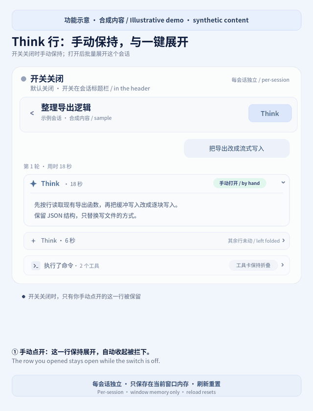

# dsh-think-expand

[](#dsh-think-expand) [](README.en.md)

DeepSeek Harness 的 Web 插件，做两件事：

1. **你手动点开的 Think 不会再被自动收起。** 装上就生效，不用点插件、不用开开关。DSH 和 dsh-claude-style 主题会在思考结束、过程组结束、轮次结束时把 Think 收起来，插件会让你亲手点开的那几行一直开着，直到你自己再点一下把它收起。
2. **每个会话一个 `Think` 开关。** 在会话标题栏点 `Think`，只有这个窗口里的这个会话会展开或收起全部 Think。DSH 0.1.7 起把 Think 收进了步骤分组（例如「执行了命令」「已完成分析」）和折叠的轮次里，开关打开时插件会先打开装有 Think 的分组和轮次，再展开其中的 Think。工具卡片、上下文注入、压缩行不会被打开。

## 预览



*功能示意，使用合成内容。动画先展示手动点开的 Think 保持展开，再展示点击会话标题栏的 `Think` 后批量展开思考；工具卡保留折叠。真实界面随 DSH 版本和主题变化。*

[查看静态图](docs/demo.png)

## 安装与第一次使用

需要 `dsh` 0.1.7-rc.2 或更新版本，以及 `web` 配置。当前版本按官方 0.2.2-rc.1 网页端和 dsh-claude-style 0.20.1 主题的发布代码适配（这一版主题要求 dsh 0.2.2-rc.1 或更新）；开关部分曾在 0.2.1-rc.4 加 dsh-claude-style 0.19.5 上实测。

### 从 GitHub 安装

```sh
dsh plugin --profile web add github:BrianHIO-x/dsh-think-expand
```

安装到其他 profile 时，将命令中的 `web` 替换成实际运行网页端的 profile 名。

### 开始使用

1. 重启运行这个 profile 的 `dsh web`，再刷新网页。终端应出现 `[dsh-think-expand] plugin loaded!`。
2. 打开任意会话，亲手点开一条 Think。插件默认会让这条思考保持展开，你自己收起后即停止保持。
3. 要批量展开当前会话的全部思考，点击**会话标题栏的 `Think` 按钮**；再次点击会收起全部 Think。这个总开关默认关闭，与默认生效的“保持手动展开”分别工作。

状态只保存在当前窗口的内存里，**刷新或新开窗口会重置**。切换会话后再回来，当前窗口内的状态仍保留。工具卡片不会跟着批量展开。

### 其他安装方式

[Releases](https://github.com/BrianHIO-x/dsh-think-expand/releases) 提供打包好的 `.tgz`，下载后可直接安装文件：

```sh
dsh plugin --profile web add /path/to/dsh-think-expand.tgz
```

本地开发目录也可直接安装：

```sh
dsh plugin --profile web add /path/to/dsh-think-expand
```

两种方式都在安装后重启对应网页端并刷新页面。

DSH Go（手机 App）：插件在 App 的「网页版」和网页插件面板里照常生效。App 自己的原生聊天列表由 Flutter 绘制，思考行在回复结束时收起的逻辑写在 App 里，插件改不到；想让整轮不被收成一行摘要，可以在 App 设置里关掉「完成后收起过程」。

卸载：

```sh
dsh plugin --profile web remove dsh-think-expand
```

## 行为

### 手动点开的 Think 保持展开（默认生效）

- 不需要任何设置。插件一加载就生效，开关关着也一样。
- 你亲手点开（鼠标或回车、空格）的 Think 行会被记住，之后这几种自动收起都会被挡掉或者撤回：
  - dsh-claude-style 在思考结束时自动收起 Think 行，在过程组的工作结束、或同一轮出现新的过程组时自动收起过程组。插件在窗口层面先拦下这些程序触发的点击，主题的折叠动画根本不会开始，页面不会闪一下再弹开。
  - DSH 在一轮结束时折叠这一轮（「用时 X 分 X 秒」那一行），同时把里面的 Think 重置为收起。对最新的一轮，插件会把它重新打开，再展开你点开过的 Think。更早的轮次被折叠时插件不去动它，你自己展开那一轮后，里面你点开过的 Think 仍然是展开的。
  - DSH 把一轮的步骤收进分组时会重建 Think 行，新建的行默认收起。插件按会话、消息和行的位置认出它就是你点开过的那一行，再把它打开。
- 你自己点一下把这行收起，插件就不再管它。你亲手收起的分组或轮次也保持收起。
- 这里的记忆只在当前窗口的内存里，刷新或新开窗口后从头开始。
- 关掉会话标题栏的 `Think` 开关时，这个会话里的记忆会被清空，开关照旧收起全部 Think。
- 没有点开过任何 Think 时，插件不监听页面；点开过之后，只在有 Think 行出现、或有东西被折叠展开时检查一次，流式输出的正文不会触发检查。

### 开关的作用范围

- 开关默认关闭。关闭时插件不会替你展开任何 Think 行，展开和收起由你手动操作，上面「保持展开」的规则照常生效。
- 每个会话有自己的开关，只作用于当前窗口主区域里的这个会话。打开某个会话的开关，其他会话保持关闭。
- 子智能体也一样：在主区域打开子智能体会话时，它的开关默认关闭，可以单独打开。右侧边栏里打开的子智能体会话没有标题栏，所以没有开关，开关也不会去动它；你在那里亲手点开的 Think 同样保持展开。
- 开关状态只保存在当前窗口的内存里。切到别的会话再切回来，原来的开关状态还在；新开的窗口和刷新后的页面，所有会话的开关都重新从关闭开始。旧版本保存在浏览器里的全局开关会被清除。

### 开关打开后

- 只匹配官方 Think 行（`data-variant="think"`）。
- 插件会打开装有 Think 的步骤分组和折叠的轮次（「用时 X 分 X 秒」那一行），然后只展开其中的 Think。分组里的工具行保持收起，不含 Think 的分组保持折叠。
- 一轮结束后 DSH 会自动折叠这一轮，开关打开时插件会把它重新打开。
- 手动收起的 Think 行、分组或轮次会保持收起，直到下一次点开关。
- 关掉开关时，插件收起这个会话的全部 Think，并把它自己打开过的分组和轮次折叠回去；你自己打开的分组和轮次不受影响。
- 插件打开分组和轮次时不会移动焦点，对话不会因此跳动。
- 开关打开时，步骤分组跟着内容一起变高，整段对话作为一个整体滚动。DSH 给展开的分组设了最高 400 像素、带独立滚动条的盒子，全部展开后滚轮会被这些盒子接走，往上滑时页面几乎不动，「加载更早」载入的历史也就看不到。开关关闭的会话保持 DSH 原本的样子。
- 插件展开或收起内容时会保住你正在看的位置：你上方的内容变长或变短，视野里的那一行留在原处。点「加载更早」后，你停在原来的位置，更早的内容在上方，和 DSH 原本的行为一致。你一滚动、点击或按键，插件立刻不再干预；跟随最新输出时由 DSH 自己处理。
- 只有你亲手的点击和按键才算手动操作。其他插件用程序触发的展开或收起（例如主题在思考结束后自动收起 Think 行）不会被记成你的选择，开关打开时插件会把这些行重新展开。
- 兼容给折叠加动画的主题（例如 dsh-claude-style）。这类主题会在动画期间吞掉对话区的点击，所以插件用 Think 行自带的回车键切换它，不经过点击；分组和轮次的点击如果被吞掉，插件会在动画结束后重试，每个控件最多 5 次。

### 性能

- 开关关闭的会话，插件只做上面「保持展开」需要的那一点工作。
- 开关打开时，插件只观察这一个会话的对话区。流式输出的正文和正在写入的思考内容不会触发扫描，只有新的 Think 行出现、或者有分组、轮次、Think 行被折叠或展开时，插件才检查一次。

## 常见问题

- **安装后标题栏没有 Think 按钮：** 确认安装的 profile 与实际运行网页端的 profile 一致，重启后刷新网页。终端的 `plugin loaded!` 只说明宿主部分已加载；若按钮仍未出现，检查浏览器控制台中的模块加载错误。
- **打开总开关前没有自动展开全部思考：** 默认行为是保持你亲手点开的行。批量展开需要点击会话标题栏的 `Think`。
- **刷新后开关关闭了：** 开关和手动展开的记忆只保存在当前窗口内存中，刷新后重新开始。
- **手机原生聊天列表里没变化：** 本插件作用于 DSH Web 的网页 DOM；手机原生界面的使用范围见上方说明。

## 开发与发布

```sh
npm install --ignore-scripts
npm run check
```

检查覆盖 JavaScript 语法、回归测试和实际打包内容。[发布说明](PUBLISHING.md) 记录 GitHub Release、npm 和社区目录的更新方式。演示图使用合成内容，原生页面的兼容性请按实际测试环境记录。

## 更新记录

- **0.3.0**：新增默认生效的「手动点开的 Think 保持展开」，不用点插件、不用开开关；专门适配 dsh-claude-style 0.20.1 的自动收起；按 DSH 0.2.2-rc.1 核对过页面结构。
- **0.2.1**：开关打开时，步骤分组跟着内容变高，「加载更早」和滚轮恢复正常。
- **0.2.0**：开关改为每个会话一个、默认关闭，只保存在当前窗口。
- **0.1.2 至 0.1.4**：支持 DSH 0.1.7 的步骤分组和折叠轮次，兼容带折叠动画的主题。
- **0.1.0 至 0.1.1**：标题栏 `Think` 开关，一键展开或收起全部 Think。

## 许可证

MIT
